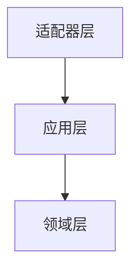
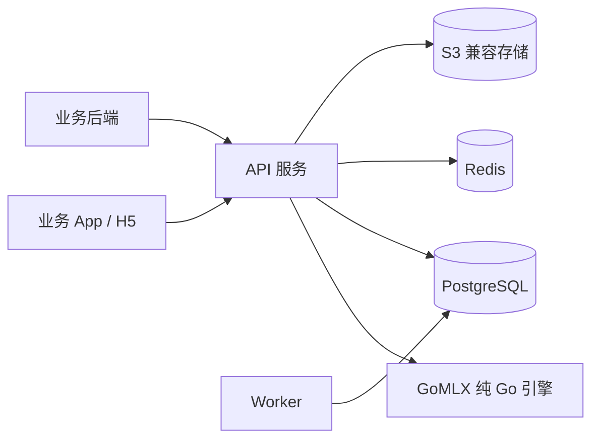

# 01 项目架构

> 文档编号：01
> 项目：Go版人脸核验服务
> 状态：已实现
> 证据基线：`docs/需求/0001/0001-Go版人脸核验服务-实施方案.md`

## 1. 组件职责

采用洋葱架构：领域层居中，应用层包裹领域层，适配器层在最外，组装根负责注入。

| 层 | 组件 | 入口 | 职责 |
| --- | --- | --- | --- |
| 领域层 | 领域模型 | `internal/domain` | 实体、值对象、动作规则、活体聚合、相似度、策略、错误码 |
| 应用层 | 端口 | `internal/port` | 仓储、引擎、缓存、加密、令牌、时钟、存储接口 |
| 应用层 | 用例 | `internal/app` | challenge、动作、录入、核验、主体、认证、清理 |
| 适配器层 | HTTP | `internal/adapter/web` | 路由、鉴权、限流、multipart、响应信封、内嵌 H5 |
| 适配器层 | PostgreSQL | `internal/adapter/pg` | pgx 仓储与事务 |
| 适配器层 | Redis | `internal/adapter/redis` | challenge 与配额 |
| 适配器层 | 推理 | `internal/adapter/onnx` | onnx-gomlx 加载、GoMLX 纯 Go 推理、图像前后处理 |
| 适配器层 | 安全 | `internal/adapter/sec` | AES-GCM、租户密钥库、端上 JWT、结果令牌 |
| 适配器层 | 对象存储 | `internal/adapter/s3` | S3 兼容实现，默认关闭 |
| 适配器层 | 种子 | `internal/adapter/seed` | dev 租户幂等种子 |
| 组装根 | API 与 Worker | `cmd/api`、`cmd/worker` | 配置、依赖注入、启动预热、清理调度 |

## 2. 启动依赖

| 依赖 | 失败策略 |
| --- | --- |
| PostgreSQL | 不可连接则拒绝启动 |
| Redis | PING 失败则拒绝启动 |
| 三个 ONNX 模型 | 缺失或加载失败则拒绝启动 |
| 主密钥 | 仅在首次加解密时校验；缺失返回 503 |
| 对象存储 | 未启用不阻塞启动 |

生产环境额外校验：`APP_ENV != development` 时 `AUTH_ENABLE_DEV_TOKEN` 必须为 false，否则启动失败。

## 3. 依赖规则

- 领域层只依赖标准库，不感知 HTTP、数据库、Redis、ONNX、JWT。
- 应用层只依赖领域层与端口接口，不直接引用 pgx、go-redis、GoMLX。
- 适配器层实现 `internal/application/port` 的接口，向内依赖。
- 组装根负责选择适配器并注入用例，不写业务规则。
- 领域层不反向调用应用层或适配器层；跨层调用通过接口与值对象传递。

## 4. 数据边界

| 数据 | 位置 | 说明 |
| --- | --- | --- |
| 主体与档案 | PostgreSQL `face_subjects`、`face_profiles` | 档案只存加密特征 |
| 会话 | PostgreSQL `face_verification_sessions` | challenge、分数、活体状态 |
| 审计 | PostgreSQL `face_audit_logs` | 不含人脸图、特征、证件号、JWT |
| challenge | Redis | 一次性，GETDEL 消费 |
| 租户密钥 | PostgreSQL `face_tenant_keys` | 主密钥包裹，主密钥只来自环境变量 |
| 原始帧 | 不落库 | 仅在请求内存中处理，请求结束释放 |
| 证件与 1:N | 表结构存在，接口未开放 | 本期不写入 |

## 5. 部署形态

- 单二进制，`CGO_ENABLED=0`，无原生推理库。
- API 与 Worker 分开部署，共享数据库与 Redis。
- 模型目录只读挂载；模型版本变更需重新录入档案。
- 多实例部署时 challenge 一次性由 Redis GETDEL 保证。
