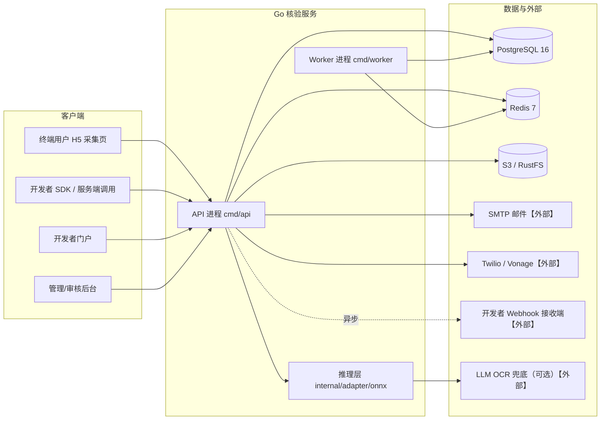
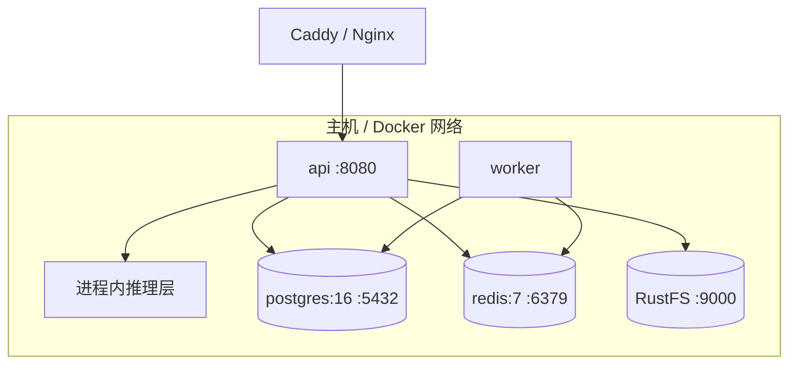
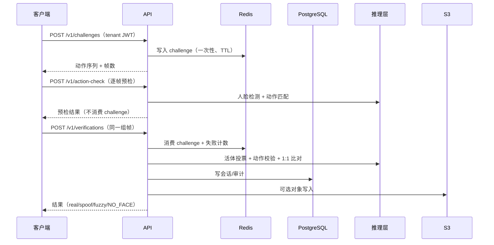
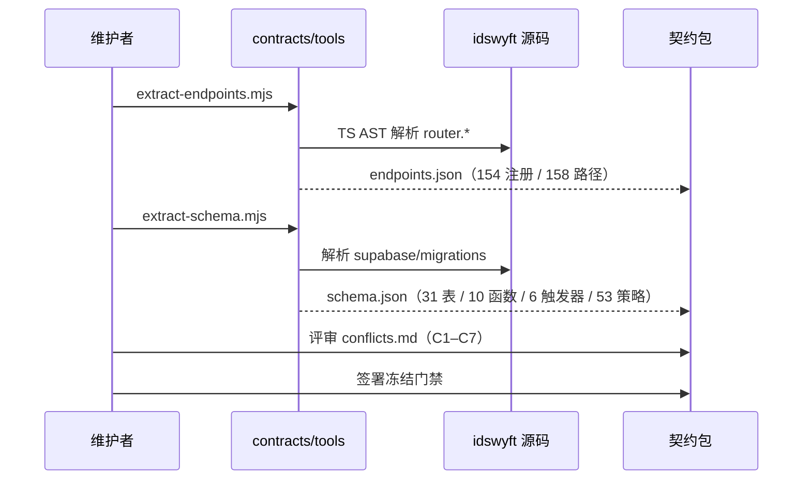

# 架构全景图

本文件回答系统由谁组成、跑在哪里、一次请求如何流动。组件职责、启动顺序与数据表见 [功能/01-项目架构](功能/01-项目架构.md)；契约清单见 [../contracts/README.md](../contracts/README.md)。

## 1. 系统上下文

> 重写目标：上图为 Go 基座当前形态（人脸 1:1 + 活体 + 语音内核）。idswyft 契约级 1:1 后，`API` 扩展为 154 接口、`PG` 为 31 表、`Engine` 扩展为 6 个 ML 端点，并新增前端 22 页与 3 套 SDK。见 [../contracts/endpoints.json](../contracts/endpoints.json)。

## 2. 部署拓扑

| 组件 | 端口 | 职责 | 说明 |
| --- | --- | --- | --- |
| `cmd/api` | 8080 | HTTP 入口、鉴权、限流、请求体上限 | 仅 Development 挂载 `/dev/*` |
| `cmd/worker` | - | 过期会话清理、保留期任务 | `LoadWorker` 只校验 DB/Redis/留存 |
| 推理层 | - | YuNet / SFace / MiniFASNetV2 | 纯 Go ONNX，`CGO_ENABLED=0` |
| PostgreSQL | 5432 | 租户、主体、档案、会话、审计 | 9 表（目标 31 表） |
| Redis | 6379 | challenge 一次性、分钟配额、活体失败锁定 | 热路径 |
| S3 / RustFS | 9000 | 证件与自拍对象 | 可关闭 |
| Caddy / Nginx | 443 | TLS、反代、静态资源 | 部署形态 |

## 3. 运行时链路

### 3.1 一次核验（当前 Go 基座）

### 3.2 一次契约冻结评审（M0）

## 4. 边界与不变式

1. 重 ML 与轻 API 分离：ONNX 只允许出现在 `internal/adapter/onnx` 与 `internal/audio`。
2. 决策确定性：Gate、活体、动作、1:1 比对不得引入 LLM。
3. 状态机严格有序：会话状态迁移必须与契约一致；`HARD_REJECTED` 在单次尝试内是终态。
4. Webhook 不阻塞响应：投递在响应后触发，失败落库重试。
5. 人脸向量不落库；日志不输出证件号、完整姓名、令牌。
6. 契约级 1:1 后：154 接口、31 表、错误码、鉴权矩阵、前端 24 路由逐条对账，缺一不可。
