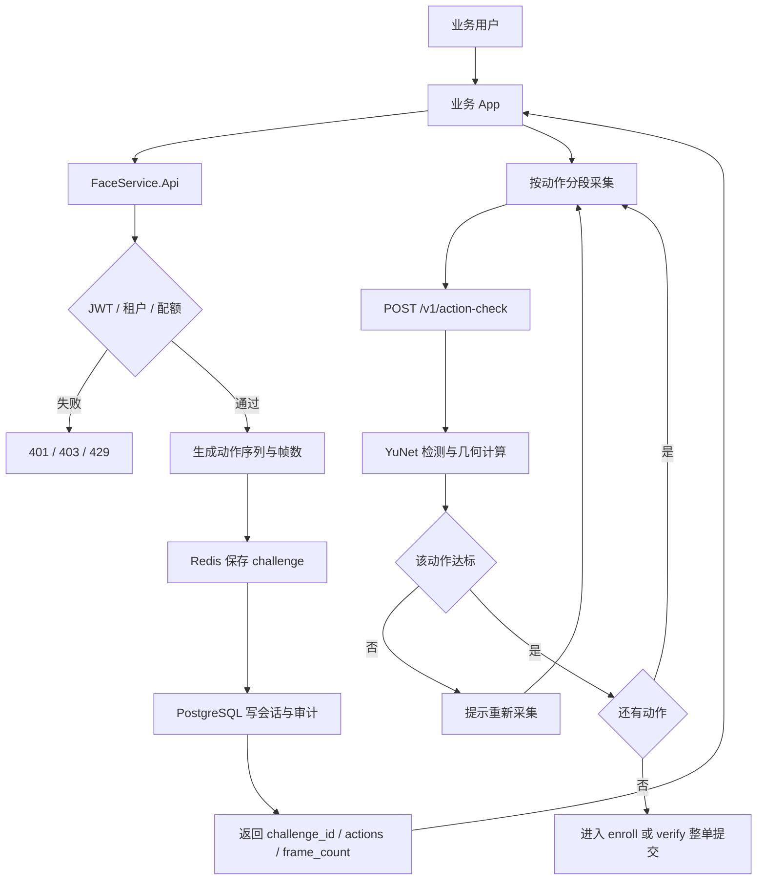
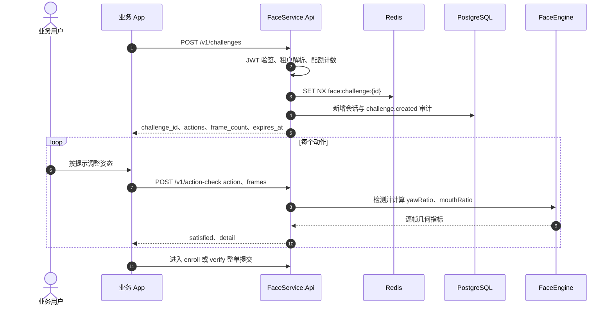
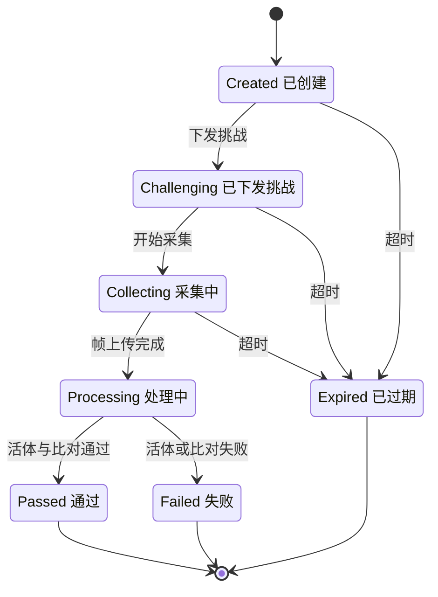

# 01 人脸采集与动作校验（v1）

> 文档编号：01
> 文档版本：v1
> 项目：Go版人脸核验服务
> 关联接口：`POST /v1/challenges`、`POST /v1/action-check`
> 状态：已实现
> 证据基线：`docs/需求/0001/0001-Go版人脸核验服务-实施方案.md`

## 1. 流程目标

业务 App 代表用户申请一次性 challenge，按服务端下发的动作序列采集帧；前端可在每个动作分段调用预检，及时提示用户调整姿态。预检不消费 challenge、不落库。

## 2. 参与角色与前置条件

| 角色 | 职责 |
| --- | --- |
| 业务用户 | 按提示完成正视、转头或张嘴 |
| 业务 App | 申请 challenge、采集帧、调用预检、展示提示 |
| 业务后端 | 签发 5 分钟 JWT |
| FaceService.Api | 验签、租户与配额校验、生成 challenge、计算几何指标 |
| Redis | 保存一次性 challenge |
| PostgreSQL | 保存会话与审计 |
| FaceEngine | YuNet 检测与 5 点几何 |

前置条件：

- 租户已注册且启用。
- JWT 含 `tenant`、`sub`、`scene`、`jti`、`ops`。
- 设备指纹已生成，challenge 与上传阶段保持一致。

## 3. 主流程图

## 4. 时序图

## 5. 状态机

## 6. 关键分支

| 场景 | 处理 |
| --- | --- |
| JWT 缺失或验签失败 | 401 `AUTH_INVALID` |
| 租户停用 | 403 `TENANT_DISABLED` |
| 租户分钟配额超限 | 429 `QUOTA_EXCEEDED` |
| `gallery` 非空 | 404 `GALLERY_NOT_FOUND`，本期 1:N 未开放 |
| challenge 已消费或过期 | 上传阶段返回 409 `CHALLENGE_EXPIRED` |
| 预检无帧 | `satisfied=false`，detail 为“无帧” |
| 预检全部帧无脸 | `satisfied=false`，detail 为 `NO_FACE` |
| 单动作通过率不足 | `satisfied=false`，返回几何范围 |

## 7. 证据索引

| 证据 | 位置 |
| --- | --- |
| 接口契约 | [实施方案](../需求/0001/0001-Go版人脸核验服务-实施方案.md) |
| 功能清单 | [02-功能清单.md](../功能/02-功能清单.md) |
| 架构边界 | [01-项目架构.md](../功能/01-项目架构.md) |
| 术语口径 | [03-领域术语表.md](../功能/03-领域术语表.md) |
| 代码与测试 | `internal/app/challenge.go`、`internal/app/action.go`、`internal/adapter/onnx/engine.go`、`internal/app/action_test.go` |
