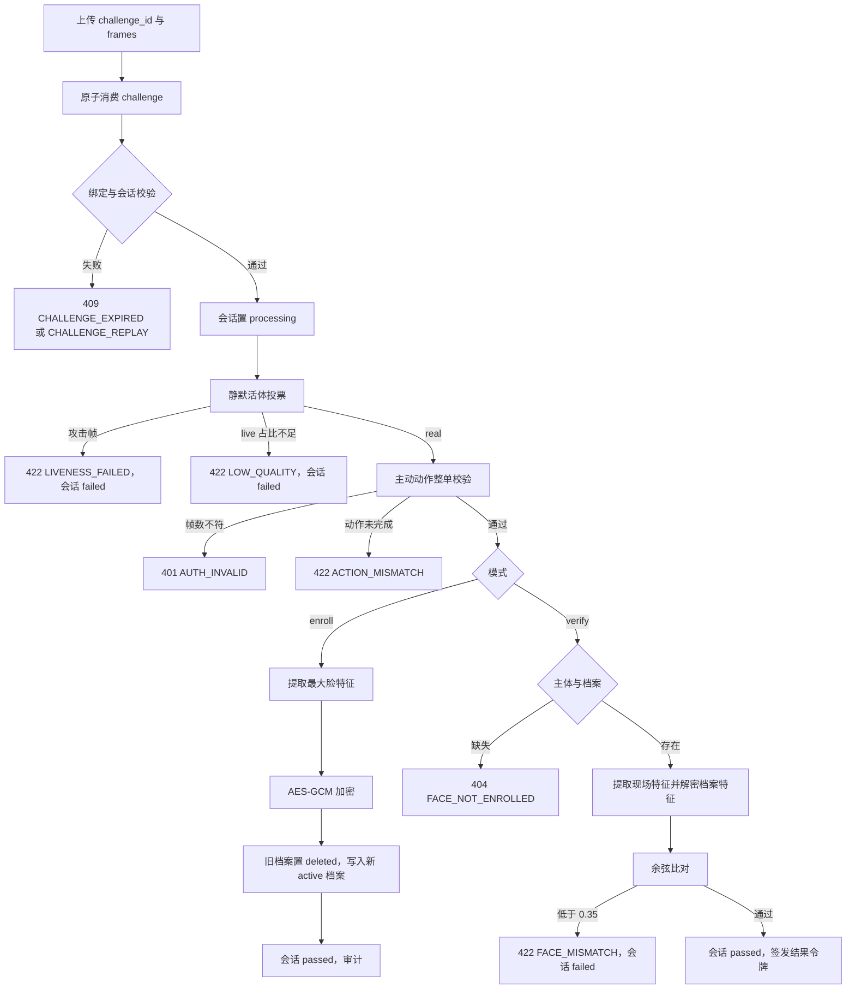
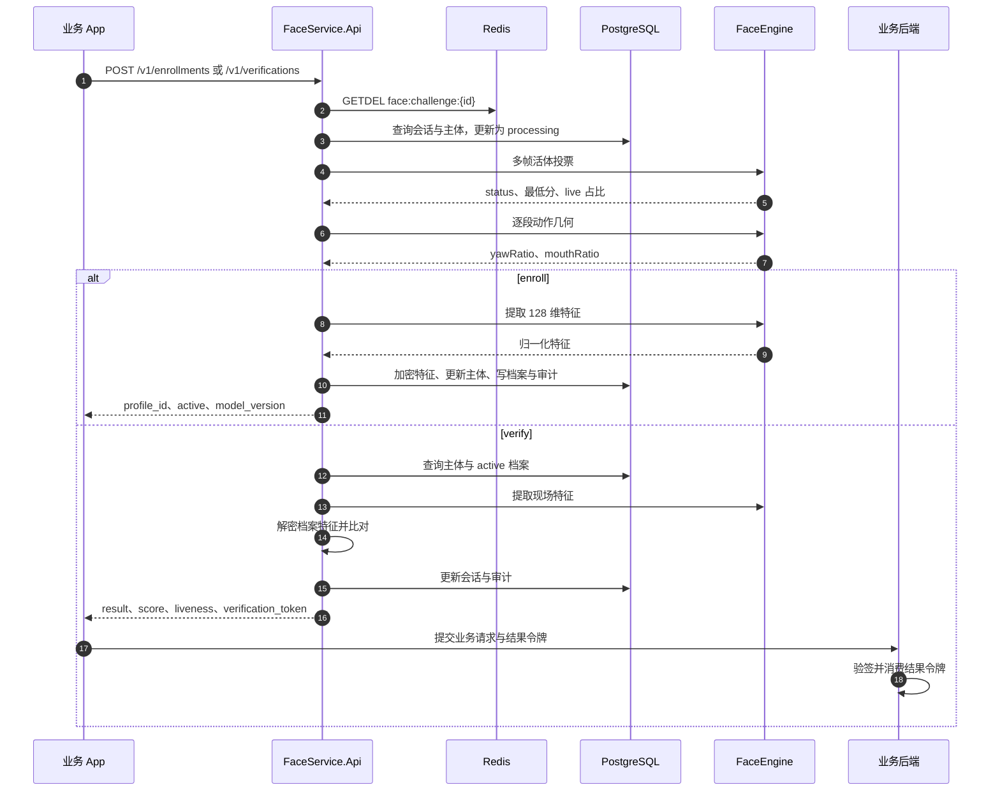
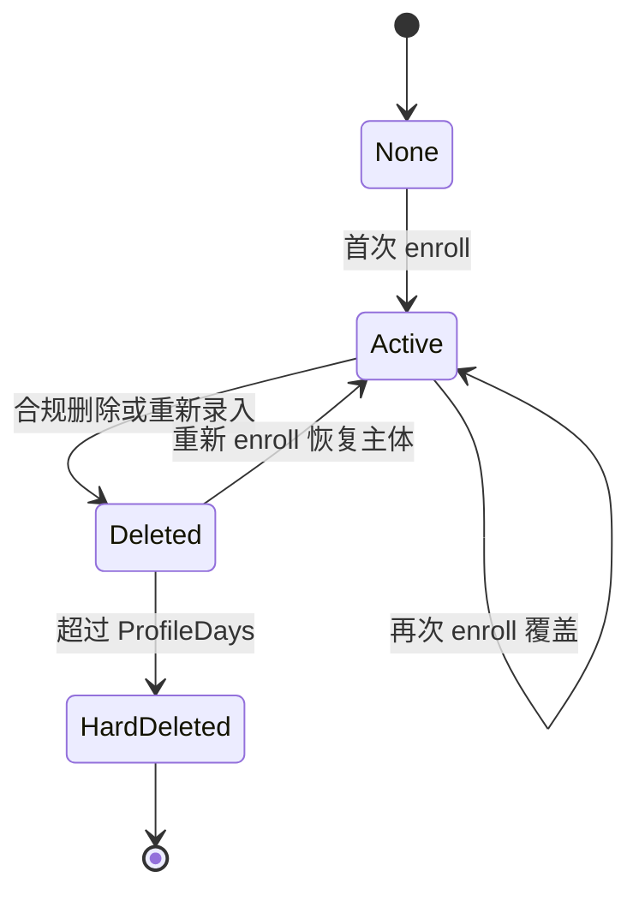

# 02 人脸档案与1比1核验（v1）

> 文档编号：02
> 文档版本：v1
> 项目：Go版人脸核验服务
> 关联接口：`POST /v1/enrollments`、`POST /v1/verifications`、`GET /v1/subjects/{subject_id}`、`DELETE /v1/subjects/{subject_id}`
> 状态：已实现
> 证据基线：`docs/需求/0001/0001-Go版人脸核验服务-实施方案.md`

## 1. 流程目标

用户在完成 challenge 采集后，平台先做静默活体投票与主动动作整单校验，再提取 SFace 128 维特征。录入路径将特征加密落库；核验路径解密档案特征并做余弦比对，通过后签发一次性结果令牌。主体查询与删除覆盖档案生命周期。

## 2. 参与角色与前置条件

| 角色 | 职责 |
| --- | --- |
| 业务 App | 提交帧、展示结果 |
| 业务后端 | 签发 JWT、验签并消费结果令牌 |
| FaceService.Api | 消费 challenge、编排活体、动作、特征、比对与删除 |
| FaceEngine | YuNet 检测、SFace 特征、MiniFASNetV2 活体 |
| PostgreSQL | 主体、档案、会话、密钥、审计 |
| Redis | challenge 一次性消费、租户配额 |
| 对象存储 | 可选，删除主体时清理审计记录中的对象键 |

前置条件：

- challenge 模式与调用路由一致。
- `enroll` 允许主体不存在；`verify` 要求主体与 active 档案已存在。
- 模型版本一致；不一致时拒绝比对。

## 3. 主流程图

## 4. 时序图

## 5. 档案生命周期

## 6. 关键分支

| 场景 | 处理 |
| --- | --- |
| challenge 不存在或已消费 | 409 `CHALLENGE_EXPIRED` |
| 租户、主体、模式或设备不一致 | 409 `CHALLENGE_REPLAY` |
| 会话已 passed 或 failed | 409 `CHALLENGE_REPLAY` |
| 无帧 | 422 `NO_FACE` |
| 攻击帧 | 422 `LIVENESS_FAILED` |
| live 占比不足 | 422 `LOW_QUALITY` |
| 帧数与动作序列不符 | 401 `AUTH_INVALID` |
| 某段无脸 | 422 `NO_FACE` |
| 某段动作通过率不足 | 422 `ACTION_MISMATCH` |
| 主体未录入 | 404 `FACE_NOT_ENROLLED` |
| 模型版本不一致 | 503 `SERVICE_UNAVAILABLE` |
| 比对分数低于阈值 | 422 `FACE_MISMATCH` |
| 主体删除 | 档案置 deleted、成员清理、对象清理、主体置 deleted |

## 7. 证据索引

| 证据 | 位置 |
| --- | --- |
| 接口契约 | [实施方案](../需求/0001/0001-Go版人脸核验服务-实施方案.md) |
| 功能清单 | [02-功能清单.md](../功能/02-功能清单.md) |
| 架构边界 | [01-项目架构.md](../功能/01-项目架构.md) |
| 术语口径 | [03-领域术语表.md](../功能/03-领域术语表.md) |
| 代码与测试 | `internal/app/enroll.go`、`internal/app/verify.go`、`internal/app/subject.go`；手工 HTTP 冒烟见方案验收 |
