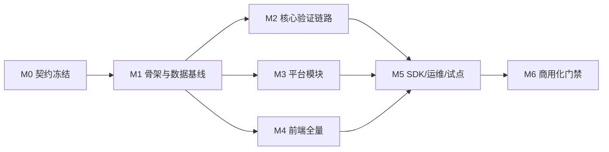
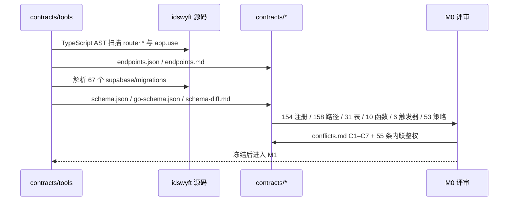
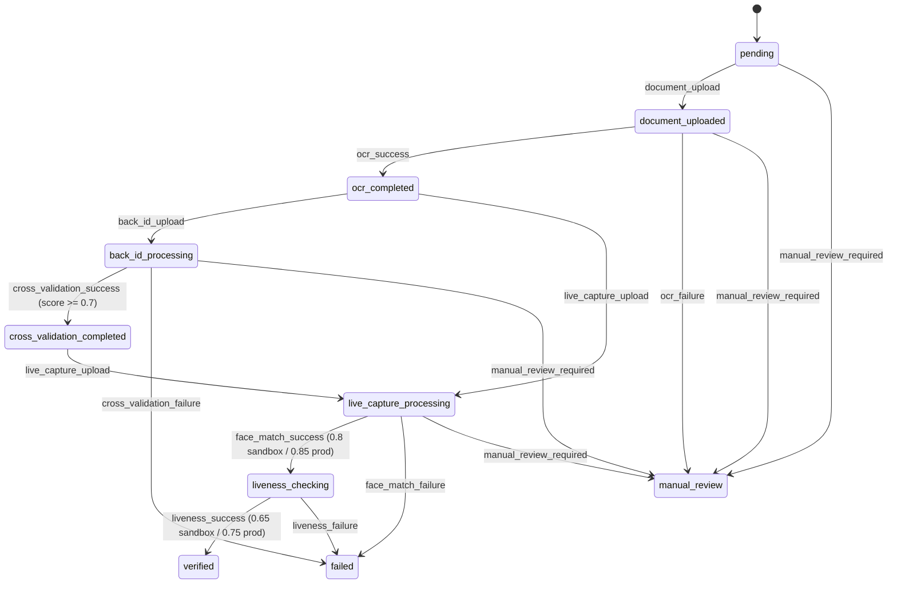
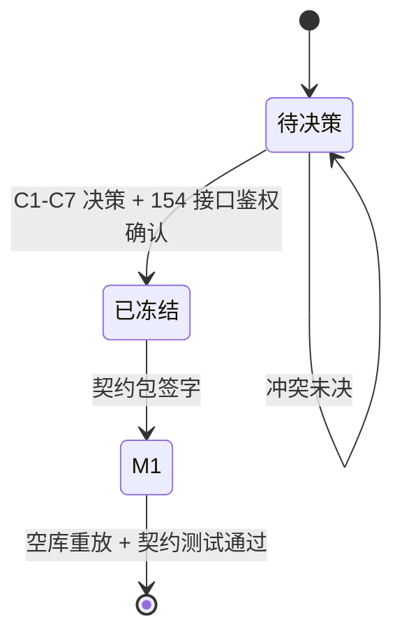

# 03 idswyft重写与契约冻结（v1）

> 文档编号：03
> 文档版本：v1
> 项目：Go 版身份核验服务
> 关联接口：154 条 idswyft 接口（见 `contracts/endpoints.json`）
> 状态：P0/M1 完成（2026-11-18）；P1 核心 15 接口、6/6 引擎端点与集成基线完成
> 证据基线：`contracts/`、idswyft `83dd51b`、Go `badcc5c`

## 1. 目标与角色

把 idswyft 的对外行为按**契约级 1:1** 重写到 Go 基座：154 接口、31 表、错误码、鉴权矩阵、前端 24 路由逐条对账。角色：维护者（契约评审）、后端/引擎/前端实现者、审核与运营验收方。

前置：`contracts/endpoints.json`、`contracts/schema.json`、`contracts/schema-diff.md`、`contracts/conflicts.md` 已生成；C1–C7 待决策。

## 2. 阶段流程

| 阶段 | 交付 | 退出条件 |
| --- | --- | --- |
| M0 | 契约包 + 冲突决策 | 154/31 签字；C1–C7 决策；字段契约完成 |
| P1 | 鉴权矩阵、S3/SMTP/SMS/Webhook、9 定时任务、核心 15 接口 + 6 引擎端点 | 32/158 契约路由可跑；引擎 6/6 |
| M2 | 15 核心接口 + 6 引擎端点 + 语音 + 交叉校验 | 端到端试点链路通过 |
| M3 | 管理/开发者/合规/VC/vault/批量/交接/VaaS | 154/154 parity |
| M4 | 24 路由 / 22 页 Vue3+Arco | 截图 diff + 交互脚本达标 |
| M5 | 3 SDK、安装脚本、压测/混沌、runbook | 试点上线 |
| M6 | PAD/精度/合规证据 | 商用门禁（另立） |

## 3. 契约抽取时序

## 4. 验证状态机（idswyft 契约）

> 口径提醒：对外 API 的 `status` 使用 shared `VerificationStatus`（12 值：`AWAITING_FRONT` … `COMPLETE`、`HARD_REJECTED`），`final_result` 为 `verified`/`failed`/`manual_review`；本节状态机是内部 `VerificationState`（`pending` …）。两者不得混用，见 `contracts/conflicts.md` C8。

12 状态、12 事件；迁移表来自 `backend/src/services/verificationStateMachine.ts:37-121`。

补充：

- `ocr_processing`、`face_matching` 是异步处理中间态，由处理流程写入，状态机只定义事件迁移。
- `failed`、`verified`、`manual_review` 为终态；重新验证走 `/re-verify` 新建请求。
- 阈值：交叉校验 ≥ 0.7；人脸比对 0.8（沙箱）/ 0.85（生产）；活体 0.65（沙箱）/ 0.75（生产）。

## 5. M0 冻结门禁

门禁清单：

- [x] 154 条接口鉴权分类：17 条公开候选已签字；P1 路由已接入 API Key/handoff/session/service-token
- [x] 31 表 + 10 函数 + 6 触发器 + 53 策略决策（C1 新库独立、C5 应用层重写）
- [x] C1–C8 决策记录（`contracts/conflicts.md`）
- [x] 请求/响应字段契约（`fields.json` / `responses.json`）
- [ ] 前端 24 路由 / 22 页截图基线
- [x] 引擎 6 端点字段契约（`contracts/engine-fields.md`，映射到 16 个 Zod schema）
- [x] `/extract/ocr`、`/extract/front` 已接入（其余 4 个引擎端点待 M2）
- [x] OCR 中英模型、自动方向、精确/分桶、黄金集与 P95（`eval/ocr/`）
- [ ] 许可证审计
- [x] M1 表/列重放对账（`contracts/m1-replay.md`）

## 6. 关键异常

| 异常 | 处理 |
| --- | --- |
| 静态解析漏项 | 数量校验（154/31）失败即非 0 退出；M1 用 pg_dump 重放对账 |
| DO $$ 动态块 | 16 个块静态不可见，M1 必须重放 |
| 内联鉴权 | 55 条标记待复核，不得默认公开 |
| 分数不可比 | 字段级 1:1，值不承诺一致；独立校准 |
| 迁移顺序 | 重复数字前缀按文件名自然序；与 idswyft 迁移器对齐 |
| 同库并存 | 与 .NET 共享库时双写一致性风险；优先新库独立 |

## 7. 证据索引

| 结论 | 证据 |
| --- | --- |
| 154 接口 | `contracts/endpoints.json`、`backend/src/routes/*`、`backend/src/server.ts` |
| 31 表 / 329 列 | `contracts/schema.json`、`supabase/migrations/*` |
| 状态机 | `backend/src/services/verificationStateMachine.ts:3-121` |
| 6 引擎端点 | `engine/src/routes/extract.ts:13-30` |
| OCR/语音栈 | `engine/src/providers/ocr/PaddleOCRProvider.ts`、`engine/src/services/voiceSpeaker.ts` |
| 前端 22 页 | `frontend/src/pages/*` |

## 8. 实现风险

- OCR 纯 Go 等价（最大不确定项，M0/P0 spike）。
- face-api 128d → SFace 512d 的阈值与分数分布。
- 前端采集 UX 1:1（动作预检与提交同帧、移动交接、语音挑战）。
- 154 接口鉴权矩阵与错误码对账成本。
- 商用可信度：复刻不提升 PAD；商用门禁另立。
