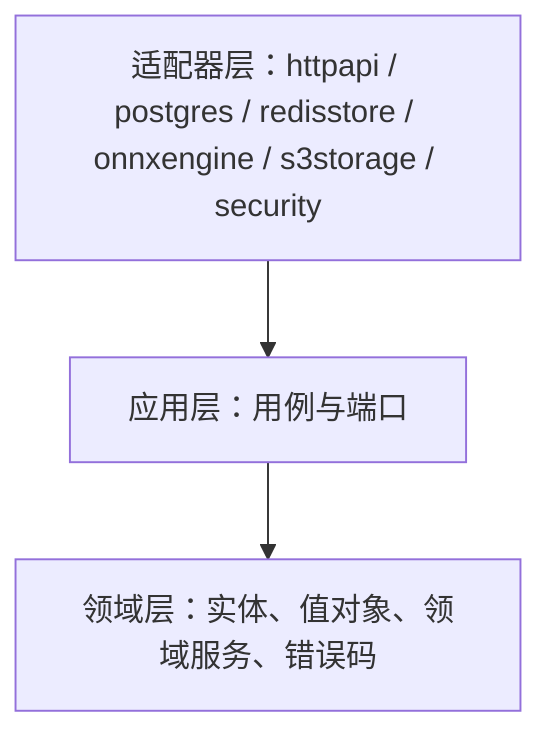

# 0001 Go版人脸核验服务 — 实施方案

> 需求清单：[0001-Go版人脸核验服务-需求清单.md](0001-Go版人脸核验服务-需求清单.md)
> 分支：`main`（目标仓库尚未初始化 Git） ｜ 日期：2026-11-14 ｜ 状态：已实现，本机联调通过

## 1. 目标与范围

用 Go 1.27 复刻基线当前可工作的 HTTP 语义、存储语义、加密语义与人脸流水线。唯一替换点是推理层：`onnx-gomlx` + GoMLX 纯 Go 后端。接口契约、错误码、阈值、数据表与模型版本保持与基线一致。

本期范围：

- 六个业务路由、两个 dev 路由、两个健康探针。
- challenge、action-check、enroll、verify、subject 查询与删除五条用例链。
- PostgreSQL 持久化、Redis challenge 与配额、AES-GCM 租户密钥、Worker 清理任务。

不在本期：`sessions`、`matches`、`liveness-checks`、`identifications`、`documents`、`operations`、`results consume`。

## 2. 洋葱架构与包结构

采用洋葱架构：领域层在最内，应用层包裹领域层，适配器层在最外。依赖只允许由外向内，禁止反向引用。



依赖规则：

| 层 | 可以依赖 | 禁止依赖 |
| --- | --- | --- |
| 领域层 | 仅标准库 | 应用层、适配器层、任何第三方框架 |
| 应用层 | 领域层、端口接口 | pgx、Redis 客户端、GoMLX、HTTP 框架 |
| 适配器层 | 应用层、领域层、第三方库 | 其他适配器的内部实现 |
| 组装根 | 全部层 | 不承载业务规则 |

端口独立成 `internal/port`，由适配器实现；`port` 只依赖 `domain`，`app` 依赖 `port` 与 `domain`。

```text
facial-liveness-verification-go/
├── cmd/
│   ├── api/main.go                 # 组装根：配置、适配器、用例、HTTP 服务
│   └── worker/main.go              # 组装根：清理任务
├── internal/
│   ├── domain/                     # 实体、值对象、领域服务、错误码
│   ├── port/                       # 仓储、引擎、缓存、加密、令牌、时钟、存储端口
│   ├── app/                        # challenge/action/enroll/verify/subject/auth/cleanup
│   ├── adapter/
│   │   ├── web/                    # HTTP、中间件、multipart、响应信封、内嵌 H5
│   │   ├── pg/                     # pgx 仓储与事务
│   │   ├── redis/                  # challenge 与配额
│   │   ├── onnx/                   # onnx-gomlx + GoMLX 纯 Go 后端
│   │   ├── s3/                     # S3 兼容对象存储
│   │   ├── sec/                    # AES-GCM、密钥库、JWT、结果令牌
│   │   └── seed/                   # dev 租户幂等种子
│   └── config/                     # 环境变量解析与生产安全校验
├── third_party/onnx-gomlx/         # 上游快照 + PRelu/Dropout 补丁
├── models/                         # 三个 ONNX 模型，不入库
└── docs/
```

依赖：

| 依赖 | 用途 |
| --- | --- |
| `github.com/gomlx/onnx-gomlx` | ONNX 解析与 GoMLX 图转换 |
| `github.com/gomlx/gomlx` | 纯 Go 计算后端，`GOMLX_BACKEND=go` |
| `github.com/jackc/pgx/v5` | PostgreSQL |
| `github.com/redis/go-redis/v9` | Redis |
| `github.com/golang-jwt/jwt/v5` | HS256 签发与校验 |
| `github.com/aws/aws-sdk-go-v2` | S3 兼容对象存储 |
| 标准库 `image`、`image/jpeg`、`image/png` | 图像解码 |
| `golang.org/x/image/draw` | 双线性缩放 |

不引入 cgo；构建时设置 `CGO_ENABLED=0`。

## 3. 配置契约

配置来源为环境变量，启动时解析并校验；缺失关键项时快速失败。

| 环境变量 | 默认值 | 说明 |
| --- | --- | --- |
| `APP_ENV` | `production` | `development` 时才注册 dev 路由 |
| `HTTP_ADDR` | `:8080` | HTTP 监听地址 |
| `AUTH_ENABLE_DEV_TOKEN` | `false` | 生产为 true 时启动失败 |
| `AUTH_DEV_SIGNING_KEY` | 空 | Base64，端上 JWT HS256 密钥 |
| `AUTH_RESULT_TOKEN_SIGNING_KEY` | 空 | UTF-8 原文，结果令牌 HS256 密钥 |
| `AUTH_TOKEN_TTL_SECONDS` | `300` | 端上 token 与结果令牌有效期 |
| `FACE_MODEL_DIR` | `models` | 三个模型所在目录 |
| `FACE_DETECTION_THRESHOLD` | `0.9` | 检测阈值 |
| `FACE_NMS_THRESHOLD` | `0.3` | NMS IoU 阈值 |
| `FACE_ANALYSIS_THRESHOLD` | `0.6` | 活体、特征、动作路径的检测阈值 |
| `FACE_MATCH_THRESHOLD` | `0.35` | SFace 余弦阈值 |
| `FACE_LIVENESS_THRESHOLD` | `0.85` | 单帧活体分数阈值 |
| `FACE_LIVE_RATIO_THRESHOLD` | `0.5` | live 帧占比阈值 |
| `FACE_YAW_THRESHOLD` | `0.20` | 转头判定幅度 |
| `FACE_STRAIGHT_YAW` | `0.15` | 正视判定幅度 |
| `FACE_MOUTH_OPEN_RATIO` | `1.08` | 张嘴相对基线增幅 |
| `FACE_ACTION_PASS_RATIO` | `0.5` | 每段通过帧占比 |
| `FACE_FRAMES_PER_ACTION` | `5` | 每段帧数，运行时 clamp 到 2–8 |
| `FACE_ACTIONS_COUNT` | `3` | 动作数，运行时 clamp 到 1–3 |
| `FACE_ACTION_VERIFY_ENABLED` | `true` | 是否启用主动动作 |
| `FACE_LIVENESS_CROP_SCALE` | `2.7` | 活体裁剪倍率 |
| `FACE_MAX_FRAME_BYTES` | `2097152` | 单帧上限 |
| `DATABASE_URL` | 空 | PostgreSQL 连接串 |
| `DB_VECTOR_DIMENSION` | `128` | pgvector 维度 |
| `REDIS_ADDR` | 空 | Redis 地址 |
| `REDIS_PASSWORD` | 空 | Redis 密码 |
| `REDIS_DB` | `0` | Redis 库号 |
| `REDIS_CHALLENGE_TTL_SECONDS` | `300` | challenge TTL |
| `SECURITY_MASTER_KEY` | 空 | Base64 主密钥，包裹租户数据密钥 |
| `SECURITY_ALLOWED_ORIGINS` | 空 | 逗号分隔的 CORS 来源 |
| `SECURITY_MAX_UPLOAD_BYTES` | `20971520` | 单请求总大小 |
| `RETENTION_PROFILE_DAYS` | `90` | 已删除档案硬清理天数 |
| `RATE_LIMIT_PERMIT_PER_MINUTE` | `60` | 每 IP 与每租户每分钟上限 |
| `STORAGE_ENABLED` | `false` | 对象存储开关 |
| `STORAGE_ENDPOINT` | 空 | S3 兼容端点 |
| `STORAGE_BUCKET` | 空 | 桶名 |
| `STORAGE_REGION` | `auto` | 区域 |
| `STORAGE_ACCESS_KEY` | 空 | 访问键 |
| `STORAGE_SECRET_KEY` | 空 | 密钥 |
| `STORAGE_FORCE_PATH_STYLE` | `true` | 路径风格寻址 |
| `STORAGE_SIGNED_URL_TTL_SECONDS` | `900` | 预签名有效期 |

## 4. HTTP 契约

### 4.1 通用约定

- 统一前缀 `/v1`；JSON 请求体使用 snake_case；响应信封为 `{code, message, data, request_id}`，`code=0` 表示成功，失败时为错误码字符串。
- 成功响应 `data` 内的 `request_id` 只在 subject 两个接口保留，其余接口不重复。
- 响应头写 `X-Request-Id`；错误响应的 request_id 取请求头 `X-Request-Id`，缺省时生成。
- `request_id` 格式为 `req_` 加 20 位十六进制，共 24 字符。
- JSON 序列化省略值为 null 的字段。
- 上传使用 `multipart/form-data`；`frames` 最多 15 个；单请求总大小受 `SECURITY_MAX_UPLOAD_BYTES` 限制；单帧上限受 `FACE_MAX_FRAME_BYTES` 限制。
- 写接口接受 `Idempotency-Key`，但基线未接入幂等存储，本期保持“接受但不生效”。
- 端上 JWT 的 `jti` 不占用、不校验一次性；防重放由 challenge 的 GETDEL 一次性消费保障，与基线一致。
- 未预期异常统一返回 503 与 `SERVICE_UNAVAILABLE`，消息为“服务暂不可用”。

### 4.2 认证链

每个 `/v1` 业务路由执行同一认证链，顺序与基线一致：

1. 读取 `Authorization: Bearer <token>`；缺失返回 401 `AUTH_INVALID`。
2. HS256 验签，密钥为 `AUTH_DEV_SIGNING_KEY` 的 Base64 解码字节。
3. 校验 `aud=face-service`、`exp`、`nbf`，时钟容差 30 秒；不校验 `iss`。
4. 必填 claim：`tenant`、`sub`、`scene`、`jti`、`ops`；`ops` 支持 JSON 数组或空格分隔字符串，空列表返回 401。
5. 按 `tenant` 解析租户：先按 UUID，再按 code；不存在或状态非 `active` 返回 403 `TENANT_DISABLED`。
6. 合并租户策略：全局配置为基线，`face_tenants.policy_json` 按键覆盖。
7. Redis 按分钟分桶计数，超过 `max_requests_per_minute` 返回 429 `QUOTA_EXCEEDED`。

租户策略可覆盖键：`match_threshold`、`liveness_threshold`、`live_ratio_threshold`、`yaw_threshold`、`straight_yaw`、`mouth_open_ratio`、`action_pass_ratio`、`frames_per_action`、`actions_count`、`action_verify_enabled`、`max_requests_per_minute`。`frames_per_action` 与 `actions_count` 分别 clamp 到 2–8 与 1–3。

### 4.3 POST /v1/challenges

请求（JSON 或 multipart）：

| 字段 | 类型 | 必填 | 说明 |
| --- | --- | --- | --- |
| `scene` | string | 是 | 场景，必须与 JWT 一致 |
| `mode` | string | 是 | 不区分大小写匹配 `MatchMode` |
| `gallery` | string | 否 | 非空即返回 404 `GALLERY_NOT_FOUND`，消息“1:N 检索本期未开放” |
| `device_id` | string | 是 | 设备指纹 |

处理：

- `scene`、`mode`、`device_id` 任一为空返回 401 `AUTH_INVALID`，消息“scene/mode/device_id 必填”。
- 动作序列首项固定 `straight`；`ActionVerifyEnabled=true` 且 `actions_count>1` 时，从 `turn_left`、`turn_right`、`mouth_open` 中洗牌取前 `actions_count-1` 个。
- `frame_count = min(15, frames_per_action × 动作数)`。
- challenge_id 为 `ch_` 加 32 位十六进制；nonce 为 16 位十六进制；有效期 300 秒。
- Redis 以 SET NX 写入 challenge，TTL 300 秒；同时新增会话行，状态 `challenging`。
- 写审计 `challenge.created`。

响应：`challenge_id`、`actions`、`frame_count`、`expires_at`、`nonce`。`expires_at` 使用 .NET `"o"` 等价布局 `2006-01-02T15:04:05.0000000Z07:00`。

### 4.4 POST /v1/action-check

请求（multipart）：`action`、`frames`、可选 `baseline_frames`。

处理：

- 逐帧检测并计算几何指标；无帧返回 `{satisfied:false, detail:"无帧"}`。
- 全部帧无脸返回 `{satisfied:false, detail:"NO_FACE"}`。
- baseline 取 baseline 帧中有脸帧的最小 mouthRatio；无 baseline 时为 null。
- 满足动作的帧数达到 `max(1, ceil(总帧数 × action_pass_ratio))` 判 satisfied。
- 判定口径：`straight` 为 `abs(yaw) <= straight_yaw`；`turn_left` 为 `yaw <= -yaw_threshold`；`turn_right` 为 `yaw >= yaw_threshold`；`mouth_open` 为 `mouth >= baseline × mouth_open_ratio`；未知动作对有脸帧恒为 true。
- `detail` 为 `yaw 最小值~最大值, mouth 最小值~最大值`，保留 3 位小数。
- 不消费 challenge、不写库、不写审计。

响应：`satisfied`、`detail`。

### 4.5 POST /v1/enrollments

请求（multipart）：`challenge_id`、`device_id`（可空）、`frames`。

处理顺序：

1. challenge 原子消费，失败或过期返回 409 `CHALLENGE_EXPIRED`。
2. 校验租户、JWT sub、mode、device_id 与 challenge 一致；不一致返回 409 `CHALLENGE_REPLAY`。
3. 会话必须存在且未处于 `passed` 或 `failed`；主体按 JWT sub 取或建，已删除主体恢复为 active；会话置 `processing`。
4. 无帧返回 422 `NO_FACE`，消息“未收到任何帧”。
5. 活体投票：任一攻击帧返回 422 `LIVENESS_FAILED`；live 占比不足返回 422 `LOW_QUALITY`；两种失败都先将会话置 `failed`。
6. 动作整单校验：帧数必须等于 `动作数 × 每段帧数`，否则返回 401 `AUTH_INVALID`，消息“帧数与动作序列不匹配”；逐段校验，某段无脸返回 422 `NO_FACE`，某段通过率不足返回 422 `ACTION_MISMATCH` 并附几何范围。
7. 逐帧取最大脸并提取 128 维特征；全部无脸返回 422 `NO_FACE`。
8. 将特征按 float32 小端字节序列使用租户 AES-GCM 密钥加密。
9. 旧 active 档案置 `deleted`；写入新 active 档案，模型版本取引擎常量。
10. 会话置 `passed`，写审计 `enroll.completed`。

响应：`profile_id`（32 位无连字符 UUID）、`status="active"`、`model_version`。

### 4.6 POST /v1/verifications

请求（multipart）：`challenge_id`、`device_id`（可空）、`frames`。

处理顺序：

1. challenge 消费与绑定校验同 enroll，mode 为 `verify`。
2. 无帧返回 422 `NO_FACE`。
3. 活体投票同 enroll，失败分别返回 `LIVENESS_FAILED` 与 `LOW_QUALITY`。
4. 主体不存在或非 active 返回 404 `FACE_NOT_ENROLLED`；此分支不写失败会话。
5. 动作整单校验同 enroll。
6. 无 active 档案返回 404 `FACE_NOT_ENROLLED`；模型版本不一致返回 503 `SERVICE_UNAVAILABLE`，消息“特征版本不一致，请重新录入”。
7. 提取现场特征，解密档案特征，计算点积作为余弦相似度（两侧均已 L2 归一化）。
8. 分数四舍五入到 5 位小数，采用远离零方向；`score >= match_threshold` 判通过。
9. 会话置 `passed` 或 `failed`，写入分数、活体状态、最低活体分与 live 占比，写审计 `verification.completed`。
10. 不通过返回 422 `FACE_MISMATCH`，消息包含 4 位小数分数与阈值。
11. 通过签发结果令牌并返回。

响应：`result="passed"`、`score`、`liveness="real"`、`verification_token`。

结果令牌：HS256，`iss=face-service`，`aud=租户 code`，有效期 300 秒；claim 为 `tenant`、`sub`、`scene`、`ref`（非空时）、`result`、`liveness`、`score`（非空时）、`jti`。签名密钥使用 `AUTH_RESULT_TOKEN_SIGNING_KEY` 的 UTF-8 原文，不做 Base64 解码；返回值为原始 JWT 字符串，不加前缀。

### 4.7 GET /v1/subjects/{subject_id}

- 路径参数按外部主体 ID 查询；不存在或已删除返回 404 `FACE_NOT_ENROLLED`。
- 状态：主体 active 且存在 active 档案时为 `active`，否则为 `pending`。
- 响应：`subject_id`、`status`、`model_version`（可空）、`request_id`。

### 4.8 DELETE /v1/subjects/{subject_id}

处理：

1. 查询主体；不存在返回 404 `FACE_NOT_ENROLLED`。
2. active 档案置 `deleted`；`cleaned.profile` 记录是否存在。
3. 删除该主体在全部 gallery 的向量成员；`cleaned.gallery_members` 与 profile 是否存在一致。
4. 扫描 resource 为 `subject:{id}` 的审计记录，收集 `detail_json.keys` 中的对象键并删除对象；单键失败只记日志；审计 `detail_json` 清为 `{}`；`cleaned.images` 记录是否收集到键。
5. 主体置 `deleted` 并写 `deleted_at`。
6. 写审计 `subject.deleted`，detail 为 cleaned 映射。

响应：`subject_id`、`deleted="deleted"`、`cleaned`、`request_id`。

### 4.9 Dev 与健康探针

- `POST /dev/token`：仅 `APP_ENV=development` 且 `AUTH_ENABLE_DEV_TOKEN=true` 时注册。请求体可选 `{"sub":"..."}`；claims 固定 `tenant=dev`、`scene=kyc`、`ops` 全量、`iss=dev`、`aud=face-service`、5 分钟；响应 `token`、`tenant="dev"`、`sub`、`expires_at`（Unix 秒）。
- 启动时幂等确保 `face_tenants` 存在 `code=dev` 的 active 租户；不存在则生成随机 UUID 插入。
- `GET /dev/face-test.html`：仅 development 提供静态页，响应头禁止缓存。
- `GET /health/live`：200 `{"status":"live"}`。
- `GET /health/ready`：数据库可连且 Redis PING 成功时 200 `{"status":"ready","engine":"mica-sface-128d-1.0.2"}`，否则 503。

## 5. 引擎流水线

### 5.1 推理后端

- 三个模型在启动时加载并转换为 GoMLX 计算图；共享同一进程，按模型各自加互斥锁串行执行，避免纯 Go 后端并发争抢。
- 直接使用 `github.com/gomlx/compute/gobackend` 纯 Go 后端（等价于 `GOMLX_BACKEND=go`）；不注册 XLA 后端，不触发 cgo。
- `third_party/onnx-gomlx` 维护三个最小补丁：排除同时作为 graph input 的 initializer；PRelu 拆为 `max(x,0)+slope*min(x,0)`；Dropout 推理期恒等。
- 模型缺失或加载失败直接终止启动，返回 503 语义的启动错误。
- 模型版本常量固定为 `mica-sface-128d-1.0.2`，写入档案与就绪探针。

### 5.2 图像解码

- 仅接受 JPEG 与 PNG；解码失败返回 422 `LOW_QUALITY`，消息“图片解码失败（仅支持 JPEG/PNG）”。
- 统一转换为 8 位 RGBA 像素缓冲，后续通道换算与平台无关。

### 5.3 YuNet 检测

- letterbox：`scale = min(640/W, 640/H)`；缩放后宽高四舍五入；画布 640×640 填黑，缩放图贴左上角，右与下补 0。
- 双线性采样，等价基线 `SKFilterQuality.Low`。
- 输入 BGR 三通道 CHW float，`scale=1`、`offset=0`。
- 输出 12 张量：`cls_8/16/32`、`obj_8/16/32`、`bbox_8/16/32`、`kps_8/16/32`。
- 解码：stride 为 8、16、32，grid 为 80、40、20；按 stride 顺序、行优先遍历。
- 分数：`score = max(cls, 0)`、`iou = max(obj, 0)`、`s2 = sqrt(score × iou)`；若 `s2 < scale` 则 `score = s2`。此处的比较对象是图像缩放系数，不是阈值，属于基线既有行为，必须保留。
- 跳过 `score < threshold` 的候选；框解码为 `(col + dx) × stride`、`exp(dw) × stride`，坐标乘 `1/scale` 后以 `max(v, 0)` 收紧下界并裁剪到图像宽高。
- 关键点为 5 组，坐标同样乘 stride 与逆缩放；任一非有限值时整组关键点置空。
- NMS 按候选插入顺序遍历，不按分数排序；与任一已保留框的 IoU 严格大于阈值则丢弃。
- `DetectAll` 使用 `detection_threshold=0.9`；活体、特征、动作路径统一使用 `analysis_threshold=0.6`。

### 5.4 SFace 特征

- 选脸：逐帧检测后取面积最大的人脸；跨帧取面积最大的一帧。
- 5 点对齐：目标点为 ArcFace 112×112 标准点；按相似变换（旋转、缩放、平移）求正变换，再按逆映射双线性采样；越界像素取 0。
- 输入 RGB 三通道 CHW float，`scale=1`、`offset=0`；输出 `fc1` 128 维；L2 归一化后返回。
- 无脸或关键点缺失返回 422 `NO_FACE`，消息“关键点缺失，无法对齐”。

### 5.5 MiniFASNetV2 活体

- 对每帧取最大脸，按 `side = max(halfW, halfH) × 2.7` 计算方形裁剪，中心为人脸框中心，边界 clamp 到图像内；裁剪后缩放到 80×80。
- 输入 BGR CHW float；输出 `output` 3 类 logits；softmax 后取索引 1 的概率为 live 分。
- 单帧判 live 的条件：`score >= liveness_threshold` 或 `argmax == 1`；否则计攻击帧。
- 汇总：`judged = live + attack`；`judged=0` 返回 422 `NO_FACE`；任一攻击帧则状态 `spoof`；否则 `live/judged >= live_ratio_threshold` 为 `real`，否则 `fuzzy`。
- 返回最低 live 分与 live 占比，分别写入会话 `clarity` 与 `reality`。

### 5.6 关键点几何

- 双眼中点 X 与瞳距；瞳距小于 `1e-3` 或关键点缺失时返回 `(有脸, yaw=0, mouth=0)`。
- `yawRatio = (鼻尖X − 双眼中点X) / 瞳距`。
- `mouthRatio = 鼻尖到双嘴角中点的欧氏距离 / 瞳距`。
- 无脸返回 `(无脸, 0, 0)`。

### 5.7 特征比对

- 两个 128 维向量逐元素乘积累加，返回 float64 点积。
- 维度不一致返回 503 `SERVICE_UNAVAILABLE`，消息包含两侧维度。
- 特征落库前为 float32 小端字节；读取时按 4 字节还原为 float32。

## 6. 存储与安全契约

### 6.1 PostgreSQL

- 复用 `docs/需求/0001/sql/` 下 11 张表的 DDL，不新增表、不新增列。
- 所有业务查询强制带 `tenant_id`；跨租户访问返回空。
- 枚举以 snake_case 文本存储；`profile` 的 active 唯一索引由 DDL 保证。
- 连接池使用 pgx；启动时 `Ping` 失败即退出。

### 6.2 Redis

| 键 | 用途 | 语义 |
| --- | --- | --- |
| `face:challenge:{id}` | challenge | SET NX + TTL；消费用 GETDEL |
| `face:quota:{tenantN}:{yyyyMMddHHmm}` | 租户分钟配额 | INCR，首次设置 70 秒 TTL |
| `face:jti:{jti}` | 端上 jti | 本期不写入 |
| `face:rtjti:{jti}` | 结果令牌 jti | 本期不写入 |
| `face:idem:{tenantN}:{sha256}` | 幂等 | 本期不写入 |
| `face:nonce:{client}:{sha256}` | 服务间 nonce | 本期不写入 |

`{tenantN}` 为 32 位无连字符 UUID，`{sha256}` 为十六进制大写。

### 6.3 JWT

- 端上 token：HS256；密钥为 `AUTH_DEV_SIGNING_KEY` 的 Base64 解码字节；`aud=face-service`；不校验 `iss`；容差 30 秒。
- 结果令牌：HS256；密钥为 `AUTH_RESULT_TOKEN_SIGNING_KEY` 的 UTF-8 原文；`iss=face-service`；不校验 `aud`；容差 30 秒。
- 结果令牌只签发，不在本期提供校验与消费路由。

### 6.4 AES-GCM 与租户密钥

- 密文布局：`nonce(12) || ciphertext || tag(16)`。
- 密钥不足 32 字节时先做 SHA-256；正好 32 字节直接使用。
- 租户数据密钥为 32 字节随机值，由主密钥 AES-GCM 包裹后存 `face_tenant_keys.key_cipher`。
- 首次使用某租户时生成数据密钥，按 `UNIQUE (tenant_id, key_version)` 冲突忽略语义写入，再重读权威记录。
- 主密钥缺失或非 Base64、数据密钥解不开时返回 503，拒绝处理人脸特征，不降级明文。

### 6.5 对象存储

- S3 兼容实现，默认 `STORAGE_ENABLED=false`。
- 删除主体时若存储未启用，对象删除抛错被捕获并记日志，不阻断删除主流程，与基线一致。
- 不把原始帧写入公网可读位置；预签名有效期默认 900 秒。

## 7. 错误码契约

| 错误码 | HTTP | 触发点 |
| --- | --- | --- |
| `AUTH_INVALID` | 401 | 缺少或非法 Bearer、JWT 验签失败、必填 claim 缺失、字段缺失、帧数与动作序列不匹配 |
| `TENANT_DISABLED` | 403 | 租户不存在或停用 |
| `QUOTA_EXCEEDED` | 429 | 租户分钟配额或 IP 限流超限 |
| `CHALLENGE_EXPIRED` | 409 | challenge 不存在、已消费、已过期、会话缺失 |
| `CHALLENGE_REPLAY` | 409 | 租户、主体、模式、设备不一致，或会话已完成 |
| `NO_FACE` | 422 | 无帧、全部帧无脸、关键点缺失 |
| `MULTI_FACE` | 422 | 契约保留；当前引擎取最大脸，不主动返回 |
| `LOW_QUALITY` | 422 | 活体 Fuzzy、图片解码失败 |
| `LIVENESS_FAILED` | 422 | 活体出现攻击帧、活体裁剪为空 |
| `ACTION_MISMATCH` | 422 | 主动动作整单校验未通过 |
| `FACE_MISMATCH` | 422 | 1:1 分数低于阈值 |
| `FACE_NOT_ENROLLED` | 404 | 主体或 active 档案不存在 |
| `GALLERY_NOT_FOUND` | 404 | challenge 携带 gallery |
| `IDENTIFY_REVIEW` | 200 | 契约保留，本期不返回 |
| `DOCUMENT_UNSUPPORTED` | 422 | 契约保留，本期不返回 |
| `DOCUMENT_LOW_CONFIDENCE` | 422 | 契约保留，本期不返回 |
| `DOCUMENT_INVALID` | 422 | 契约保留，本期不返回 |
| `SERVICE_UNAVAILABLE` | 503 | 模型、密钥、解密、维度、未预期异常 |
| `DEV_DISABLED` | 404 | dev 路由不可用 |
| `OPERATION_NOT_FOUND` | 404 | 契约保留，本期不返回 |

## 8. 会话与审计语义

- 会话状态推进：`challenging`（创建）→ `processing`（上传开始）→ `passed` 或 `failed`（收尾）→ `expired`（Worker）。
- challenge 消费与绑定校验发生在活体与动作校验之前；一旦消费不可重放。
- `enroll` 的活体失败、质量失败、动作失败都会先写会话失败状态再返回错误；`verify` 的主体未录入分支不写会话。
- 审计动作固定为 `challenge.created`、`enroll.completed`、`verification.completed`、`subject.deleted`。
- 审计 detail 只含非敏感元数据：模式、帧数、活体状态、分数、对象键、清理项。
- 日志不得输出人脸图、特征向量、证件号、完整姓名、JWT 原文。

## 9. 链路与生效点

| 功能点 | 图文档 |
| --- | --- |
| 人脸采集与主动动作校验 | [01-人脸采集与动作校验-v1.md](../../流程/01-人脸采集与动作校验-v1.md) |
| 人脸档案与 1:1 核验 | [02-人脸档案与1比1核验-v1.md](../../流程/02-人脸档案与1比1核验-v1.md) |

## 10. 改动清单

| 路径 | 改动 |
| --- | --- |
| `go.mod`、`go.sum` | 模块与依赖锁定，`replace` 指向本地 onnx-gomlx |
| `cmd/api/main.go` | 组装根：配置、适配器、用例、启动预热、HTTP 服务 |
| `cmd/worker/main.go` | 组装根：清理任务 |
| `internal/config` | 环境变量解析、默认值、生产安全校验 |
| `internal/domain` | 实体、值对象、领域服务、错误码 |
| `internal/port` | 仓储、引擎、缓存、加密、令牌、时钟、存储端口 |
| `internal/app` | challenge、action、enroll、verify、subject、auth、cleanup 用例 |
| `internal/adapter/web` | 路由、异常信封、限流、multipart、内嵌 H5 |
| `internal/adapter/pg` | pgx 仓储与事务 |
| `internal/adapter/redis` | challenge 与配额 |
| `internal/adapter/onnx` | ONNX 会话、letterbox、对齐、裁剪、解码、NMS、活体投票 |
| `internal/adapter/sec` | AES-GCM、密钥库、端上 JWT、结果令牌 |
| `internal/adapter/s3` | S3 兼容对象存储 |
| `internal/adapter/seed` | dev 租户幂等种子 |
| `internal/adapter/web/static/face-test.html` | 本地 H5 采集页，通过 `go:embed` 内嵌 |
| `third_party/onnx-gomlx` | 上游快照，补 PRelu 与 Dropout |
| `models/` | 三个 ONNX 模型，不入库 |
| `docs/需求/0001/sql/` | 基线 DDL 副本，单一来源 |
| `tests/` | 单元与集成测试 |

## 11. 边界

- 不实现基线未注册的接口；不为未实现能力补占位路由。
- 不接入 `Idempotency-Key` 幂等、端上 `jti` 一次性、服务间 HMAC；这些在基线中只有存储类，没有挂到请求链。
- 不存原始帧；仅在对象存储启用且审计记录包含 keys 时执行对象删除。
- 不支持跨租户检索；`gallery` 在 challenge 阶段直接拒绝。
- 不改变默认阈值与模型版本；阈值校准不在本期。
- 不引入 GPU 后端；纯 Go 后端只使用 CPU。

## 12. 观测点

- 指标：请求量、成功率、P50/P95 延迟、活体拒绝率、Fuzzy 率、1:1 分数分布、各错误码计数、推理耗时。
- 日志字段：`request_id`、`tenant`、`scene`、`mode`、耗时、结果、错误码；不含图片、特征、证件字段。
- 探针：`/health/live`、`/health/ready`；就绪探针返回模型版本。
- Worker 日志：过期会话数、过期证件数、硬清理档案数。

## 13. 测试与验证

- 单元测试：AES-GCM 往返与篡改、短密钥 SHA-256 派生、动作判定边界、策略动作序列、错误码契约、JWT 签发与校验。
- 集成测试：真实 PostgreSQL、Redis、三个模型；覆盖 challenge 契约、challenge 一次性、静态图动作门禁、同人录入与认证、无 Bearer 401、篡改 token 401、gallery 404、就绪探针模型版本。
- 数值回归：同一测试图对比 Go 与基线 .NET 的检测框、128 维特征余弦、活体分数、动作几何量。
- 未执行项必须列入方案验收，不得写成已通过。

## 14. 待办

| 项 | 说明 |
| --- | --- |
| 引擎 spike | 先验证三个模型在 GoMLX 纯 Go 后端的加载、形状与数值范围 |
| PRelu/Dropout 补丁 | 本地补丁并补单元测试；条件允许时向上游提 PR |
| 数值回归样本 | 准备固定人脸样本与基线输出，建立容差阈值 |
| 性能基线 | 记录单帧检测、特征、活体延迟与并发吞吐 |
| H5 页面 | 复用基线页面并按 Go 路由校正 |

## 15. 验收结论

验收条件、实测数字与未执行项见 [方案验收](0001-Go版人脸核验服务-方案验收.md)。当前状态为设计稿，尚未开始实现。


